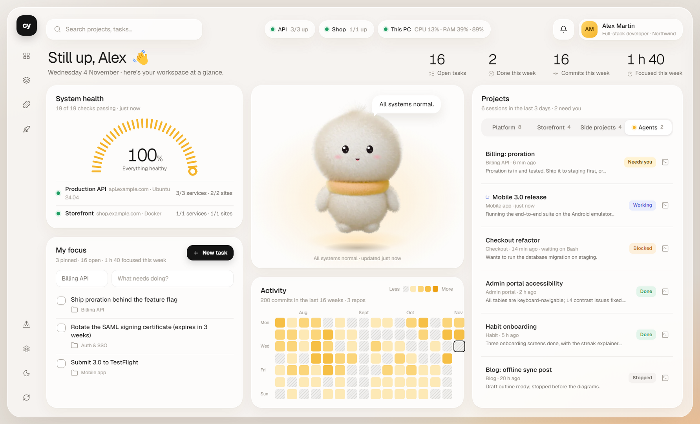
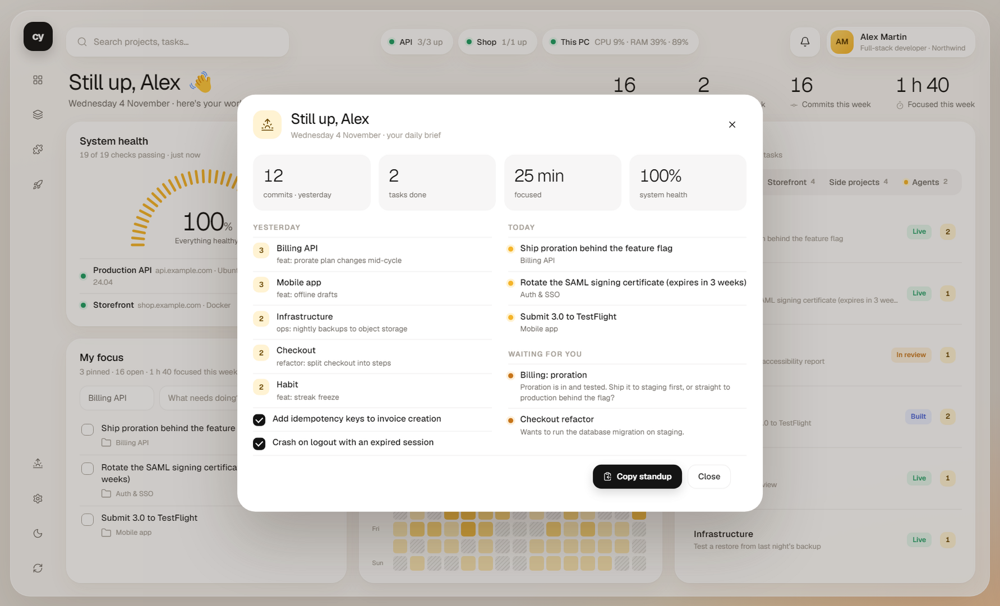

# CY Desk

**Your Windows desktop as a live workspace.** Projects and to-dos, server health, your Claude Code agents, focus sessions and a daily brief, all on the wallpaper, with **Cy**, a plush companion who watches it all, reacts to it, and sings along when you play music.


| Light | Dark |
|---|---|
|  |  |
|  |  |

<sub>Screenshots and demo come from the built-in demo mode: fictional projects, no real data.</sub>

## What it does

- **Lives on the desktop.** Pinned under every window: it stays on Win+D, clicking it never brings it in front, and it starts with Windows.
- **Cy, the companion.** A fur plush rendered in Blender. Its eyes follow the mouse anywhere on screen, but it isn't a cursor follower: it gets interested, bored and distracted. It sits down, dozes off, has ideas (tips drawn from your own data), turns around, stretches, waves and hums. Its mood is your system's state: happy when all is well, worried on warnings, grumpy when something is down.
- **Sings along.** Play music in any app and a microphone slides up: Cy sings with its mouth following the sound, sways on the beat and names the song. It stays quiet during calls (Teams, Zoom, Discord…).
- **Projects and to-dos.** Per-project task lists with focus pins, drag to reorder, quick add, search. Git activity per project: last commit, commits this week, uncommitted files, and a 16-week heatmap across all repos.
- **Claude agents board.** Every Claude Code session on the machine with its state: *working*, *needs you* (a question or a permission prompt), *done*. Cy tells you when one finishes or starts waiting. One click opens it.
- **Server health.** Read-only SSH checks of your Linux servers (load, disk, services, Docker, PM2) and HTTPS checks of your sites (status, latency, certificate expiry), summed up as one health gauge.
- **This PC.** CPU, memory, disk and battery. Cy suggests a break after a long stretch of keyboard and mouse activity, and notices a hot CPU or a low battery.
- **Focus sessions.** Start a 25-minute (or 15/50/90) block on any task. Cy keeps quiet, a ring counts down, and you get a "focused this week" total.
- **Daily brief.** On your first activity of the day: what you shipped on the last working day (commits per project, finished tasks, focus time), today's pinned tasks, agents waiting for you, and a **standup ready to paste**.
- **Settings and setup wizard.** Add servers (with a connection test), sites and project folders without touching JSON.

## Quick start

Windows 10/11 and Node 20+.

```bash
npm install          # also builds the small native audio meter with Windows' own C# compiler
npm run demo:app     # try it with a fictional workspace: no servers, nothing written to your data
npm start            # the real thing: pins itself to the desktop and opens the setup wizard
```

The tray icon has refresh, theme, *Cy sings along*, desktop icons, start with Windows and quit.

## Privacy

Everything stays on the computer.

| Feature | What is read | What is never done |
|---|---|---|
| Servers | one read-only batch of commands per server every 2 min, over SSH with your key | no writes, nothing installed |
| Claude agents | the session transcripts on this disk (`~/.claude/projects`) | nothing sent anywhere |
| Singing | Windows' volume-mixer peak levels, and the name and window title of the app playing | no recording, no capture |
| This PC | CPU, memory, disk, battery, input idle time | no keystrokes, no screen content |

## How it works

```
┌─────────────── Electron main process ───────────────┐       ┌───────────── page (software-rendered) ─────────────┐
│ lib/desktop.js   Win32 via koffi: owned by the       │       │ app.js     dashboard: health gauge, focus, heatmap, │
│                  desktop host + z-order lock         │  IPC  │            projects, agents board, search          │
│ lib/collectors   SSH probes, HTTPS/TLS, git stats    │◄─────►│ panels.js  daily brief, settings, setup wizard      │
│ lib/agents.js    Claude Code session states          │       │ mascot.js  Cy: frame blending, springs, attention   │
│ lib/vitals.js    CPU, memory, disk, activity streak  │       │            and behaviour scheduler, singing,        │
│ lib/focus.js · lib/brief.js · lib/demo.js            │       │            SVG face placed per pose                 │
│ native/audiometer.exe   COM peak meters → JSON lines │       └─────────────────────────────────────────────────────┘
└──────────────────────────────────────────────────────┘
```

Decisions worth knowing:

- **Desktop pinning.** The window is *owned* by the desktop's icon host and refuses z-order changes in `WM_WINDOWPOSCHANGING`, so it survives *Show desktop* and never covers an app, while staying clickable, unlike true wallpaper layers.
- **Software rendering, on purpose.** A desktop-owned GPU surface shows corrupt tiles on some hybrid-graphics laptops. Software rendering is clean; the budget is small animation. Cy costs about 2–3 % of one core while visible and pauses (≈0.1 %) when a maximized or fullscreen app covers the desktop.
- **Cy is pre-rendered, not real-time 3D.** `mascot/build_mascot.py` builds the plush in Blender (geometry-nodes fur, Cycles) and renders 176 poses: a 21 × 7 grid of head turns at 3° × 4°, a 16-frame turn-around, sitting, waving, cheering, sleeping, singing, and a mic layer. The page blends the nearest frames with premultiplied additive compositing, so motion is continuous, and critically damped springs drive the head with the eyes leading. The face is SVG placed with anchors exported per pose, so Cy can emote without a render per expression. Only frames near the current pose are decoded (an LRU of 80 bitmaps), which saves about 165 MB.
- **Read-only, quiet monitoring.** One batched SSH connection per server per refresh, friendly to fail2ban; cheap queries only.

## Configuration

The setup wizard and *Settings* write `config.json` (git-ignored). [`config.example.json`](config.example.json) shows every field: servers with a `probe` (`linux` for any server; `vps`, `odoo` and `plugins` for specific layouts, tuned with `vars`), sites, and groups of projects. A project can have a `repo` or `folder`, a Claude `session`, a `url`, a release `status`, or a product `stage` with a `blocker`.

Claude sessions (and you) can manage tasks from a terminal:

```bash
node todo.js items
node todo.js add billing "Ship proration behind the flag" --by "Billing session"
node todo.js done "proration"
```

## Development

```bash
npm run dev          # a normal window instead of the desktop
npm test             # 75 end-to-end checks (UI, Cy, features) in demo mode: no network needed
npm run test:live    # the UI suite against your own config
npm run demo         # records docs/cy-demo.webp and .gif
```

`--test=<file.js>` runs a scripted session (`h.js`, `h.shot`, `h.send`, `h.dryRun`); open actions are only logged. Other switches: `--demo`, `--windowed`, `--theme=light|dark`.

Rebuild Cy after changing the model (about 15 min on a laptop GPU):

```bash
blender -b --factory-startup -P mascot/build_mascot.py -- batch mascot/frames
python tools/export_mascot.py
```

One pose: `-- test out.png '{"yaw": 9, "sit": true}'`.

## Credits

Built by Yassine Chritt. Icons by [Lucide](https://lucide.dev) (ISC), font [Geist](https://vercel.com/font) (OFL), runtime [Electron](https://www.electronjs.org). See [THIRD_PARTY_NOTICES.md](THIRD_PARTY_NOTICES.md). Licensed under [MIT](LICENSE).
