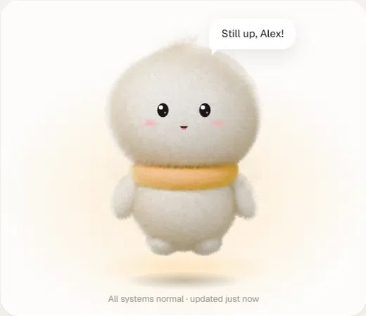
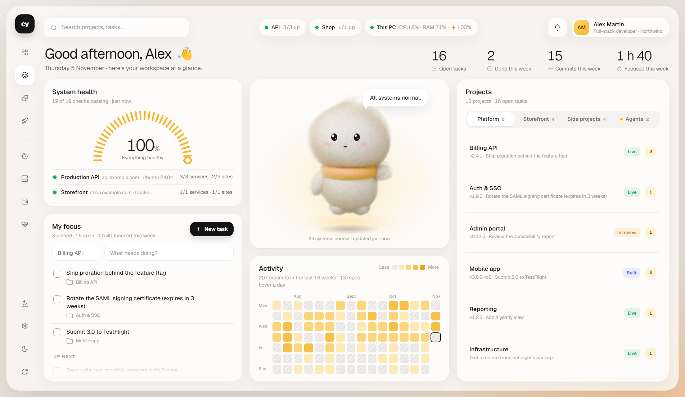
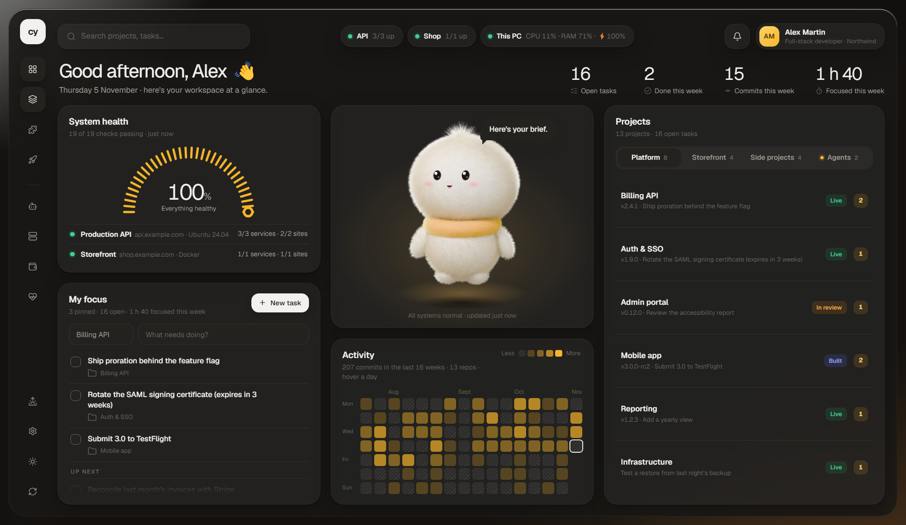
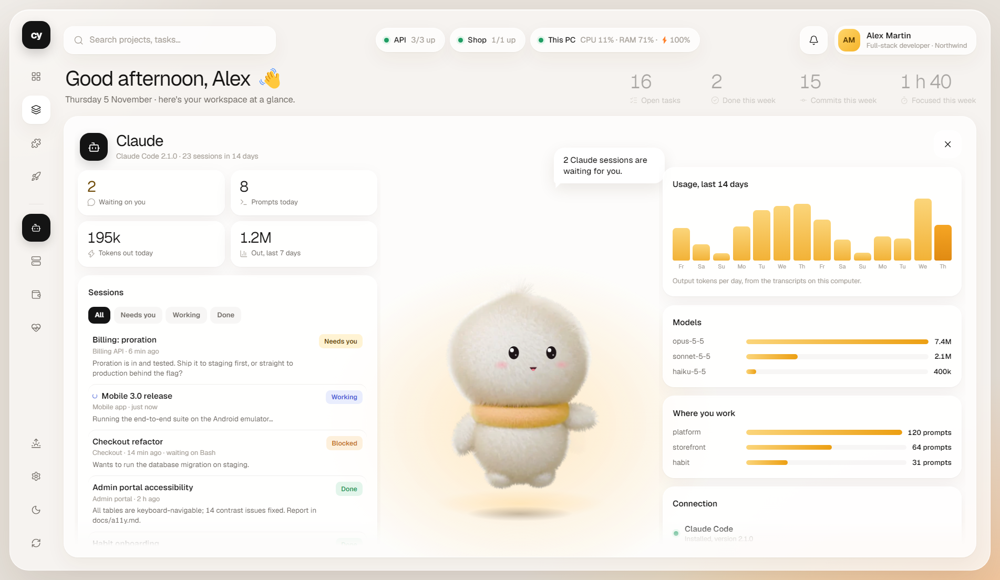
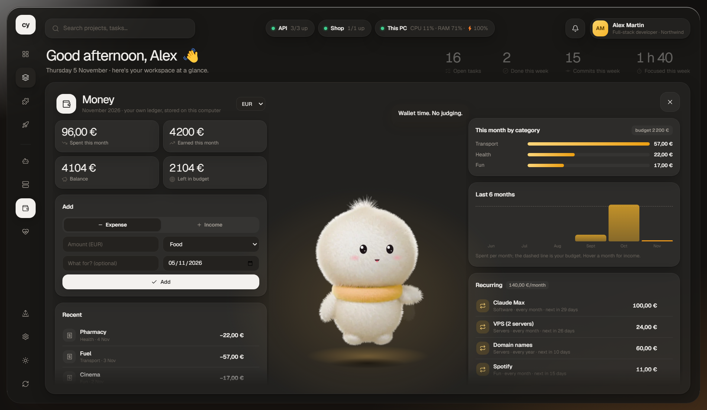
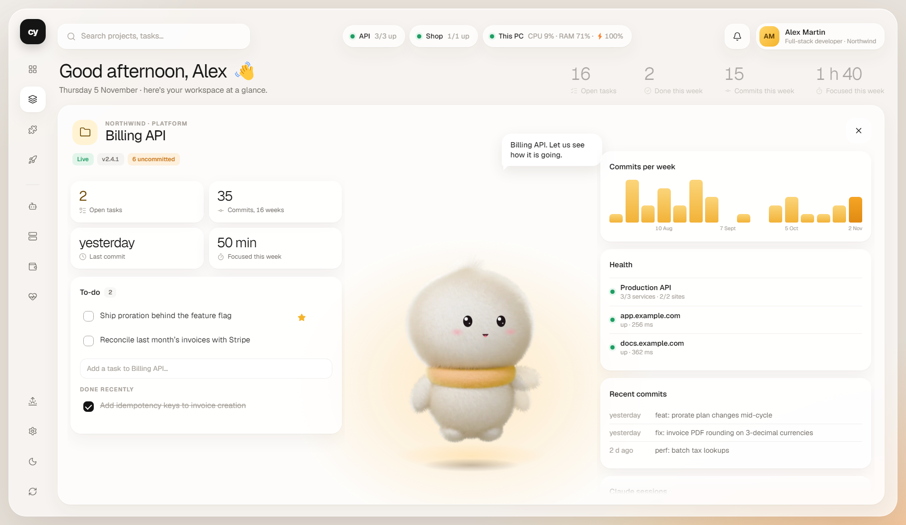

# CY Desk

**Your desktop as a live workspace, made for people who build with Claude.** Projects and to-dos, your Claude Code sessions and usage, server health, money, health and focus, all on the wallpaper, with **Cy**, a plush companion who watches it all, reacts to it, and sings along when you play music.



| Light | Dark |
|---|---|
|  |  |
|  |  |
|  |  |

<sub>Screenshots and demo come from the built-in demo mode: fictional projects, no real data.</sub>

## What it does

- **Lives on the desktop.** On Windows it is pinned under every window: it stays on Win+D and clicking it never brings it in front. On Linux it is a desktop-type window; on macOS a borderless window on every Space, raised with ⌘⌥C. It starts with the system.
- **Cy, the companion.** A fur plush rendered in Blender. It isn't a cursor follower: it gets interested, bored and distracted. It sits, dozes off, has ideas (tips from your own data), thinks, dances on Friday afternoons, plays peekaboo, has its coffee in the morning and a sandwich at lunch, nods when you add a task, cheers your new commits, and bows after a song. Its mood is your system's state.
- **Spaces.** Four buttons under the projects open a full page: the stage takes the whole dashboard, Cy stands up in the middle, bigger, and panels open on both sides.
  - **Claude**: every session with its state (*working*, *needs you*, *blocked*, *done*), tokens and prompts per day, models, where you work, a one-click new session in any project.
  - **Servers**: per server load sparkline, memory, disk, uptime, services, containers and PM2 apps, websites with latency and certificate expiry, alerts.
  - **Money**: a personal ledger, spending by category, six months against a budget, subscriptions with their next charge.
  - **Health**: screen time and breaks (from input idle time only), water, mood, stretches, bedtime reminder.
- **Project dashboards.** Click a project: its KPIs, commits per week, linked servers and sites, recent commits, its Claude sessions, and its to-do list.
- **Connected to Claude Code.** One click (Settings › Claude) registers CY Desk as an MCP server: any session can list and add your to-dos, tick them off, check your servers or log an expense. Optionally a short note in your `CLAUDE.md` tells sessions to log only what matters, never secrets.
- **Activity heatmap.** 16 weeks of commits from every project repo plus the repos you use Claude Code in. Hover a day for the commits per project and the week's total.
- **Focus.** Pin tasks, start a 15/25/50/90-minute session, add five minutes; Cy keeps quiet meanwhile.
- **Sings along** (Windows). Play music and a microphone slides up; Cy sings, sways on the beat and names the song. Never during calls.
- **Daily brief** with a standup ready to paste, **This PC** vitals with break reminders, **settings and a setup wizard**, and **your own 3D model**: pick any `.glb` and it replaces Cy, driven by the same brain (clips named idle, wave, dance, sit, sleep or cheer play at the right moments).

## Install

Download the installer for your system from the [latest release](https://github.com/EnissayCT/cy-desk/releases) (Windows `.exe`, macOS `.dmg`, Linux `.AppImage`), or run it from source with Node 20+:

```bash
git clone https://github.com/EnissayCT/cy-desk.git && cd cy-desk
npm install          # on Windows, also builds the small native audio meter with the C# compiler Windows ships
npm run demo:app     # try it with a fictional workspace: no servers, nothing written to your data
npm start            # the real thing: lives on the desktop and opens the setup wizard
```

Your settings and data go to a per-user folder: `%APPDATA%\CY Desk` on Windows, `~/Library/Application Support/CY Desk` on macOS, `~/.config/cy-desk` on Linux (tray › *Open data folder*).

| | Windows | macOS | Linux |
|---|---|---|---|
| Dashboard, spaces, Cy, Claude, servers, money, health | ✓ | ✓ | ✓ |
| Lives on the desktop layer | ✓ pinned | window on every Space, ⌘⌥C | ✓ desktop window (X11) |
| Cy sings along to music | ✓ | — | — |
| Start with the system | ✓ | ✓ | add it to your autostart |

## Connect Claude Code

Settings › Claude › **Connect** runs `claude mcp add` for you. By hand:

```bash
claude mcp add --scope user cy-desk -- node /path/to/cy-desk/mcp.js
```

Tools: `cy_list_projects`, `cy_list_todos`, `cy_add_todo`, `cy_complete_todo`, `cy_status`, `cy_add_expense`. A terminal CLI does the same for scripts: `node todo.js add billing "Ship proration" --by "Billing session"`.

## Privacy

Everything stays on the computer.

| Feature | What is read | What is never done |
|---|---|---|
| Servers | one read-only batch of commands per server every 2 min, over SSH with your key | no writes, nothing installed |
| Claude | the session transcripts on this disk (`~/.claude/projects`), streamed in small chunks | nothing sent anywhere |
| Health | input idle time: was there a key or mouse event in the last minute | no keystrokes, no screen content |
| Singing | Windows' volume-mixer peak levels and the title of the app playing | no recording |
| Money | what you type in | stays in your data folder |

## How it works

```
┌──────────────── Electron main process ────────────────┐       ┌────────────── page (software-rendered) ──────────────┐
│ lib/desktop.js    Win32 via koffi: desktop host owner  │       │ app.js     dashboard, heatmap + tooltip, focus, agents │
│ lib/platform.js   terminals, ssh, disk per OS          │  IPC  │ spaces.js  Claude, servers, money, health, projects    │
│ lib/collectors    SSH probes, HTTPS/TLS, git activity  │◄─────►│ panels.js  daily brief, settings, setup wizard         │
│ lib/claude.js     usage (worker thread), MCP connect   │       │ mascot.js  Cy: frame blending, springs, attention,     │
│ lib/ledger · health · focus · agents · todos · paths   │       │            activities, singing, SVG face per pose      │
│ native/audiometer.exe  COM peak meters → JSON lines    │       │ model.js   your .glb with three.js, driven by Cy's brain│
└────────────────────────────────────────────────────────┘       └────────────────────────────────────────────────────────┘
mcp.js  stdio MCP server for Claude Code (no dependencies)        todo.js  the same to-dos from a terminal
```

Decisions worth knowing:

- **Desktop pinning (Windows).** The window is *owned* by the desktop's icon host and refuses z-order changes in `WM_WINDOWPOSCHANGING`, so it survives *Show desktop* and never covers an app, while staying clickable.
- **Software rendering, on purpose.** A desktop-owned GPU surface shows corrupt tiles on some hybrid-graphics laptops. Cy costs about 2–3 % of one core while visible and pauses when a maximized app covers the desktop.
- **Cy is pre-rendered, not real-time 3D.** `mascot/build_mascot.py` builds the plush in Blender (geometry-nodes fur, Cycles) and renders 182 poses: a 21 × 7 grid of head turns, a turn-around, sitting, waving, cheering, sleeping, singing, dancing, thinking, pointing, holding, bowing, and a mic layer. The page blends the nearest frames, springs drive the head with the eyes leading, and the face is SVG placed with anchors exported per pose.
- **Spaces animate the real layout.** Every grid track is a length, so opening a space interpolates `grid-template-columns` instead of swapping pages.
- **Transcripts stay cheap.** Claude transcripts reach hundreds of MB; usage is read in 1 MB chunks from where the last read stopped, in a worker thread (≈75 MB peak for 2 GB of transcripts).

## Development

```bash
npm run dev          # a normal window instead of the desktop
npm test             # end-to-end suites (UI, Cy, features, spaces + MCP) in demo mode: no network needed
npm run test:live    # the UI suite against your own config
npm run dist         # installer for this OS in dist/ (CI builds all three)
```

`--test=<file.js>` runs a scripted session (`h.js`, `h.shot`, `h.send`, `h.dryRun`); open actions are only logged, and the real mouse and audio are ignored. Other switches: `--demo`, `--windowed`, `--size=WxH`, `--theme=light|dark`. CI runs the suites on Windows, macOS and Linux and builds the installers.

Rebuild Cy after changing the model (about 15 min on a laptop GPU), or only some poses:

```bash
blender -b --factory-startup -P mascot/build_mascot.py -- batch mascot/frames [point,bow]
python tools/export_mascot.py [point,bow]
```

## Credits

Built by Yassine Chritt. Icons by [Lucide](https://lucide.dev) (ISC), font [Geist](https://vercel.com/font) (OFL), 3D by [three.js](https://threejs.org) (MIT), runtime [Electron](https://www.electronjs.org). See [THIRD_PARTY_NOTICES.md](THIRD_PARTY_NOTICES.md). Licensed under [MIT](LICENSE).
